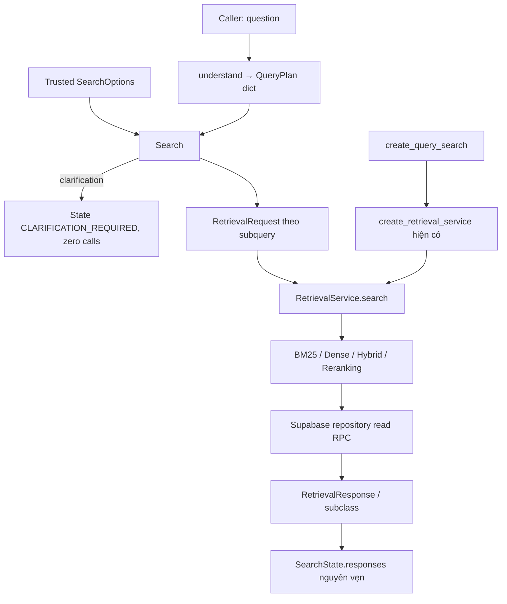

# Checkout và kiến trúc cuối

Development checkout ở D:/DOWNLOAD/Ligalli Illigal, service con tillegal-ai-main. Branch codex/tillegal-service-checkpoint, HEAD b2be67edf2cc55d0f25d301dcb3ec654f392a4a8. Trước Task 3 có 6 modified tracked gồm Query/Search/route Task 2, README, root basic_rag, chat DTO; 16 deleted root ai_core và nhiều untracked. Giữ toàn bộ các thay đổi này.

Retrieval checkout ở D:/DOWNLOAD/tillegal-ai/tillegal-ai-main. Git commands đã được chạy ngoài sandbox và trả fatal not a git repository. Vì thế không có branch/HEAD hoặc tracked status để báo cáo cho source export này. Nhận định Permission denied lượt trước không đủ để kết luận Git status. Dùng SHA256 source bên dưới để định danh, không tuyên bố clean working tree.

Chọn Retrieval checkout để giữ nguyên module imports `src.*`, bootstrap, tokenizer/index/repository contract và dependencies của bản mới. Cả hai dùng Python >=3.12, FastAPI/LangGraph/Pydantic, nhưng bản mới có sentence-transformers dependency và wheel chỉ đóng src; bản cũ có ai_core. Không thay dependencies.

Target Query/Search/graph trước task là docstring stub. Development Query đã harden và Search legacy nhận state/tools/limit; legacy graph giữ bundle/evidence_id, khác response typed của bản mới. Không ghép legacy graph/Judge/Response vào target. Public entrypoint mới là QuerySearch.search, bất đồng bộ, có thể gọi từ graph/application sau này.

Không thêm adapter chuyển evidence vì service đã nhận text. QuerySearch chỉ compose dependency và gọi Query rồi Search. Search không import Supabase client; RetrievalService sở hữu validation/read execution/deadline. Bootstrap mới chuyển tiếp toàn bộ dense/hybrid/rerank config cho bootstrap đã có.

## Source fingerprint sau task

- `src/applications/tillegal/agents/query/agent.py` — SHA256 `b196d7c02e3bc9f0b936928f84d33a4e564e8a85f9dbef60458023561de1a6dc`
- `src/applications/tillegal/agents/search/agent.py` — SHA256 `d00506511093a2eaa197552d24381f42a1db26f6a088c6f354e7975e625fb840`
- `src/query_search_bootstrap.py` — SHA256 `122c80bbaabed5044e4c760b28d459aa701818c07bbd8a64b8c00b8f09f9a1c2`
- `src/retrieval_bootstrap.py` — SHA256 `e5ef67702fc7da35ef0ebf64d88a037e50cc4364aca12764898230e5c523e986`
- `src/application/services/retrieval_service.py` — SHA256 `195651342360c3905a92155397fe3f2076ba27b288fd848d783c3f32e9a97132`