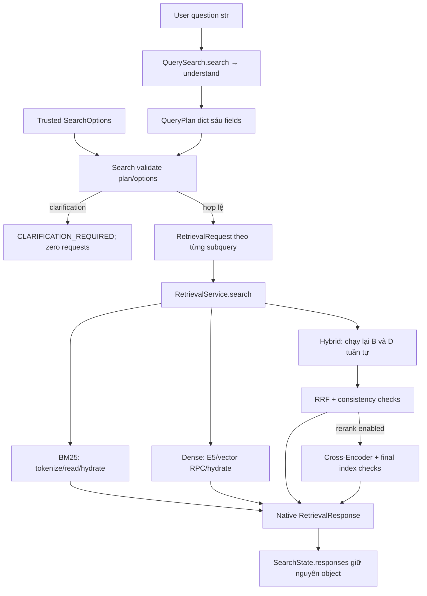

# Kiến trúc và ownership

Query tạo original/intent/domain/temporal_scope/subqueries/clarification. Graph chưa tham gia ở target này. Search lấy subqueries.text, validate plan; intent/domain/time không được dùng để cấp quyền, đổi index hoặc tự chọn model. Options mode/top_k/date/policies do application tin cậy cung cấp. Nếu clarification truthy, không gọi service.

Search tuần tự tối đa bốn requests theo QueryPlan; dựng/validate toàn bộ trước I/O; dừng tại response FAILED, giữ những response trước đó. Không retry hoặc fallback ở Search. NO_MATCH vẫn hoàn tất xử lý query. COMPLETED không đánh giá đủ bằng chứng pháp lý.

`create_query_search` chuyển tiếp settings, dense_model_path, hybrid_config, rerank_config và timeout sang `create_retrieval_service`. Bootstrap tạo read repositories, tokenizer và lazy local models. Không cần chuyển response sang legacy EvidenceBundle, không dùng ai_core. Model/path/config là dependency của runtime, không do Query chọn.

Shared resource model được encoder/reranker bảo vệ bởi threading.Lock; cancellation coroutine không bảo đảm dừng native thread ngay. State mỗi lần gọi là containers local, không checkpoint/persistence. Frozen Pydantic model vẫn có nested dict metadata mutable; caller phải tránh mutate response. Không claim đã kiểm full concurrent production lifecycle.

Source export không có branch/HEAD. [Manifest trước](evidence/source_before.json), [sau](evidence/source_after.json), [delta](evidence/source_delta.json) là evidence version. So sánh không có changed/deleted; added là test_query_search_multimode.py. `pyproject.toml` và uv.lock nằm trong phạm vi hash. Thư mục .docs mới được kiểm riêng, không dùng Git diff.
