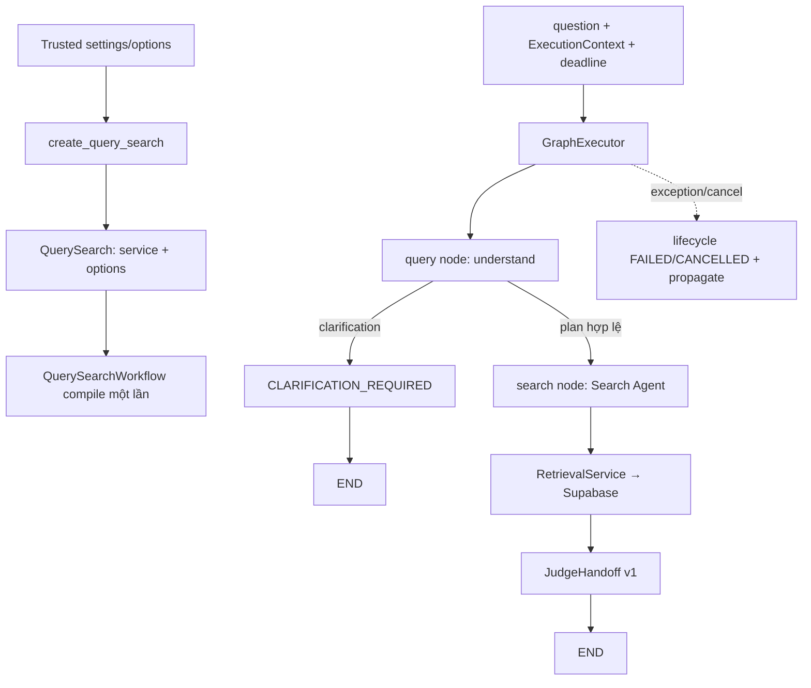

# Kiến trúc và audit

Target có9 Markdown Task 3 và 12 Task 4, đã inventory/hash tại evidence/prior-documentation-inventory.json. Task0–2 không có trong target; không dùng checkout legacy làm source. Các kết quả lịch sử được kiểm lại bằng regression mới.

Factory create_state_graph, compiler compile_graph, GraphExecutor và WorkflowState/reducers có logic thực. Foundation graph và approval/InMemorySaver riêng đã có tests. Legal QA graph/state trước task chỉ docstring stub; graph registry/checkpointer interface còn stub. Không có framework/persistence/serializers.py tại target. Postgres saver riêng không được mở hoặc setup trong task.

Không có existing graph nghiệp vụ để mở rộng, nên hoàn thiện hai stub bằng graph tối thiểu, dùng framework factory/compiler/executor. Không gọi QuerySearch.search ở Search node vì method đó gọi Query lại. Các rules/request construction vẫn thuộc Agents, không được copy vào graph.

Workflow giữ pipeline/retrieval/options đã compose application-scoped; không bootstrap/load model theo từng node. execute tạo fresh input state mỗi lượt, graph không saver. Same instance có thể xử lý nhiều invocations, isolation được test bằng fakes. Không claim resource thread safety production của shared model/DB client. Wrapper không thêm close/reinitialize theo request; lifecycle vẫn theo composition hiện hữu.

Source inventory trước323 files/sau324; delta đúng 2 stub changed/1 test added/0 deleted. Configs/pyproject/uv.lock và Agents/Retrieval không đổi. Xem evidence/source_before.json, source_after.json, source_delta.json. Không có branch/HEAD của export.
