# Routing và failure semantics

```mermaid
stateDiagram-v2
 [*] --> Query
 Query --> QUERY_COMPLETED: không clarification
 Query --> CLARIFICATION_REQUIRED: cần làm rõ
 CLARIFICATION_REQUIRED --> [*]
 QUERY_COMPLETED --> Search
 Search --> SEARCH_COMPLETED: xong và có evidence
 Search --> NO_MATCH: mọi response NO_MATCH
 Search --> RETRIEVAL_FAILED: native FAILED
 SEARCH_COMPLETED --> [*]
 NO_MATCH --> [*]
 RETRIEVAL_FAILED --> [*]
 Query --> ExecutionFailure: exception
 Search --> ExecutionFailure: unexpected exception
 ExecutionFailure --> [*]: propagate; lifecycle FAILED
```

Cancellation là out-of-band executor exit, lifecycle CANCELLED; không serialize thành retrieval result. Graph không có Judge node/retry edge/feedback cycle. Compiled nodes là __start__, query, search; END qua routing/edge.

| Case | Kết quả | Handoff | Lifecycle sau khi bắt đầu |
|---|---|---|---|
| Search xong có evidence | SEARCH_COMPLETED | READY | SUCCEEDED |
| Mọi query NO_MATCH | NO_MATCH | NO_MATCH | SUCCEEDED |
| Service FAILED, kể cả TIMEOUT | RETRIEVAL_FAILED | RETRIEVAL_FAILED | SUCCEEDED vì outcome đã xử lý |
| Clarification | CLARIFICATION_REQUIRED | None | SUCCEEDED |
| Invalid input | QueryInputError propagate | Không có final packet mới | FAILED |
| Query processing error | Underlying exception propagate | Không có final packet mới | FAILED |
| Unexpected Search error | Underlying exception propagate | Không có final packet mới | FAILED |
| Outer graph deadline | TimeoutError propagate | Không có final packet mới | FAILED |
| Token/caller cancellation | ExecutionCancelledError/CancelledError | Không có final packet mới | CANCELLED |

Lifecycle SUCCEEDED không đồng nghĩa retrieval OK hoặc legal sufficiency. Khi token đã cancel trước execute, executor hiện có raise trước lifecycle.start nên lifecycle có thể còn CREATED; Task 5 không đổi behavior này. Tests mới cancel sau Search bắt đầu để kiểm cleanup/cancellation propagation.

execute bắt buộc caller cấp timeout_seconds. Service có deadline riêng; không tự retry hoặc tăng timeout. Native model thread có thể chạy sau coroutine hủy, lock giữ tới khi worker thoát; không có hard-stop promise. Task 5 cancellation dùng cooperative fakes.

Không catch ValueError chung thành user error, không tạo HTTP route. GraphExecutor.lifecycle.error hiện có diagnostic từ underlying exception; consumer phải áp redaction policy trước khi công khai. Classified RetrievalErrorDetail được service sanitize và được giữ nguyên trong packet. Không log toàn packet/raw evidence hoặc credential trong probe.
