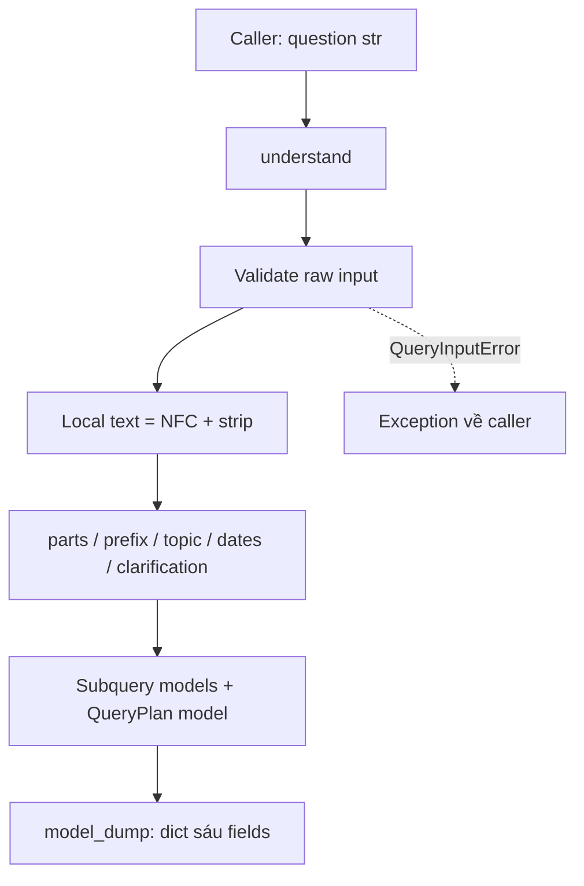
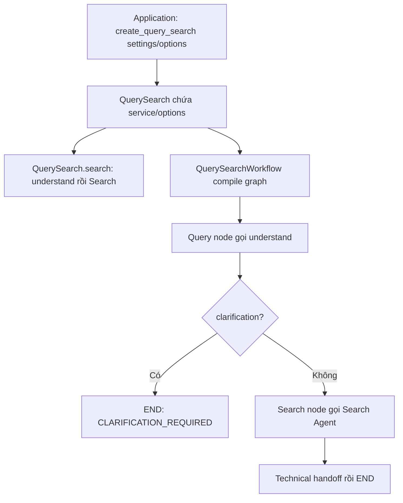
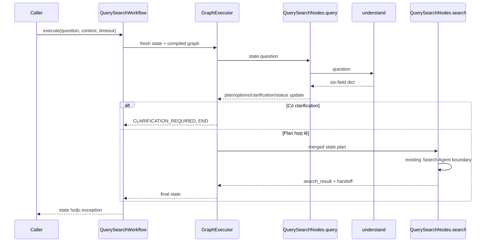

# Kiến trúc Query Agent theo source hiện tại

## Kết luận định danh

Query Agent hiện là hàm deterministic `understand(question: str) -> dict`, không có class Agent riêng. Pydantic `Subquery` và `QueryPlan` là schemas validation. Các imports và toàn thân hàm chỉ dùng re,unicodedata,datetime.date và Pydantic; không có model weights,LLM API hoặc I/O trong Query. Nguồn [agent.py, dòng3–95](../../../src/applications/tillegal/agents/query/agent.py).

| Câu hỏi năng lực | Kết luận source-grounded | Evidence và hệ quả |
|---|---|---|
| 1. Deterministic/LLM/hybrid? | Deterministic rules | understand29–95; cùng input/runtime không có random/clock/network |
| 2. Pretrained model? | Không được gọi trong Query | Imports3–8 và call graph29–95; Pydantic schemas không có ML weights |
| 3. LLM API? | Không có call | Toàn29–95; không tồn tại prompt/model routing Query |
| 4. Regex/keywords/templates? | Có | Split42,prefix45,time52,topics77–78,domain91; clarification65/71/73 là literal messages |
| 5. Semantic interpretation? | Rule-based classification | quote_only47 và keyword91; không có learned semantic representation |
| 6. Rewrite? | Structural extraction/reformatting |40–48 và74–87; bỏ prefix/tách phần/strip ký tự,không paraphrase bằng nghĩa |
| 7. Expansion? | Bổ sung bounded topic phrases có sẵn trong input |75–87; không synonym generation hoặc thêm reference luật mới |
| 8. Ambiguity? | Heuristic fixed rules |64–73; không phát hiện mọi câu thiếu tình tiết |
| 9. Temporal extraction? | Regex + calendar check |49–62; list string mentions,không time resolver |
| 10. Intent/domain? |2 intents,2 domain values |22–23,90–91; một label global cho toàn câu |
| 11. Multiple subqueries? |1–4 trong accepted plan |25,48,74–87; order được giữ |
| 12. Original input? |Giữ chính đối số |89; normalized text là local variable37 |
| 13. Confidence? |Không có field hoặc phép tính |QueryPlan20–26,constructor88–95; extra confidence bị schema bỏ trong probe |
| 14. Đổi retrieval config? |Không |QueryPlan không có mode/date/policy options; Search38–44 và bootstrap inject riêng |
| 15. Direct Supabase? |Không |Query call graph chỉ xử lý text/models; Search gọi service ở boundary sau đó |

Các kết luận vắng model/API dựa trên toàn implementation và caller map đã đọc,không suy từ tên Agent. E5/reranker thuộc Retrieval ở downstream,không được gán cho Query.

## Public entrypoints và ownership

- Standalone `agents/query/agent.py:understand`,dòng29–95: trả QueryPlan dạng dict.
- `src/query_search_bootstrap.py:QuerySearch.search`,20–21: gọi understand rồi Search Agent; không LangGraph.
- `src/applications/tillegal/graphs/legal_qa.py:QuerySearchWorkflow.execute`,76–95: graph entry,nhận ExecutionContext và deadline.
- `QuerySearchNodes.query`,24–33: gọi understand trực tiếp,một lần.
- `QuerySearchNodes.route_query`,36–37: route từ clarification.
- `agents/search/agent.py:search`,38–56: receiving boundary,revalidate plan và tạo request.

[Bootstrap](../../../src/query_search_bootstrap.py) · [Graph](../../../src/applications/tillegal/graphs/legal_qa.py) · [Search boundary](../../../src/applications/tillegal/agents/search/agent.py)

Source target `src/api/routes/chat.py` chỉ docstring. Không có current HTTP Query endpoint trong file đó. User question hiện đi vào function argument từ application caller; tests dùng synthetic strings. Mô tả User→Graph là logical entry,không phải bằng chứng production HTTP đã nối.

## Standalone thực tế

## Hai cách điều phối hiện có

Query Node không gọi QuerySearch.search,vì như vậy sẽ gộp hai bước và mất routing hoặc chạy Query hai lần. Nó reuse underlying functions với cùng dependency container. Models/retrieval config được tạo ở bootstrap; Query không đọc config hoặc môi trường.

## Sequence đến boundary Search

Đây là in-memory graph không saver; durable checkpoint/resume không được suy từ việc framework có checkpointer component riêng.
