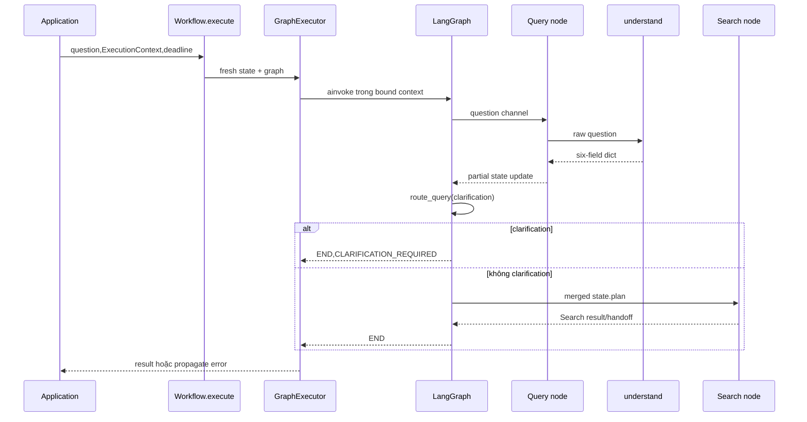

# Query trong LangGraph

Sources [graphs/legal_qa.py](../../../src/applications/tillegal/graphs/legal_qa.py),[state/legal_qa_state.py](../../../src/applications/tillegal/state/legal_qa_state.py),[factory](../../../src/framework/graphs/factory.py),[compiler](../../../src/framework/graphs/compiler.py),[executor](../../../src/framework/runtime/executor.py). Ranges đầy đủ ở16.

compile_query_search_graph57–66 tạo nodes object,create_state_graph(LegalQAState),đăng ký query/search,bắt đầu query,conditional map search→search/end→END,sau Search→END. Không có Judge node,retry loop hoặc saver argument;compiler defaultcheckpointer=None.

Query node24–33 nhận partial typed state có question,gọi understand25 rồi trả update plan/options/clarification/status,search_result=None,handoff=None. Không gọi QuerySearch.search. LegalQAState96–103 kế thừa WorkflowState,total=False;tất cả keys là optional ở TypedDict,nhưng functions vẫn cần key cụ thể ở runtime. Optional typing không tạo default question hoặc validation model.

| Channel | Update/owner | Merge |
|---|---|---|
|question,run_id,request_id |Wrapper execute84–88 |Fresh initial dict mỗi run |
|plan,options,clarification,status |Query node |Last value cho fields mới,status kế thừa |
|search_result,handoff |Reset None ở Query;Search node ghi sau |Last value |
|errors |Search đưa safe error codes |append_unique reducer framework |

QueryPlan dict được LangGraph giữ trong plan channel sau update;Search node đọc state.plan. Clarification truthy route end36–37 nên không có Search event. Search guard trực tiếp là lớp bảo vệ riêng nếu không qua graph. Querycompleted là intermediate;graphstatusNO_MATCH chỉ có sau Search fake/service response.

Input lỗi và Query exception không bị catch ở node;GraphExecutor.lifecycleFAILED rồi propagate. Token/outer timeout/caller cancellation theo runtime convention;không tạo plan hoặc packet giả. State không emit final EXECUTION_FAILED để thay exception. Prior packet không được tái dùng cho failed run.

Workflow.execute tạo mới initial input từ question/context mỗi lần,không nhận prior outputstate. Graph không có persistence nên independent invocations không share state;tests repeated/concurrent fake kiểm điều này. ExecutionContext IDs do caller cấp;không có tenant ACL/checkpoint resume trong Query graph. Framework có Postgres saver khác không chứng minh đường graph này đã dùng persistence.

Bằng chứng mới52 diagnostics có graph thật/fake Retrieval,cùng120 focused tests gồm30 graph cases. Không lặp Supabase live trong Task6a vì không cần cho kiến thức Query.
