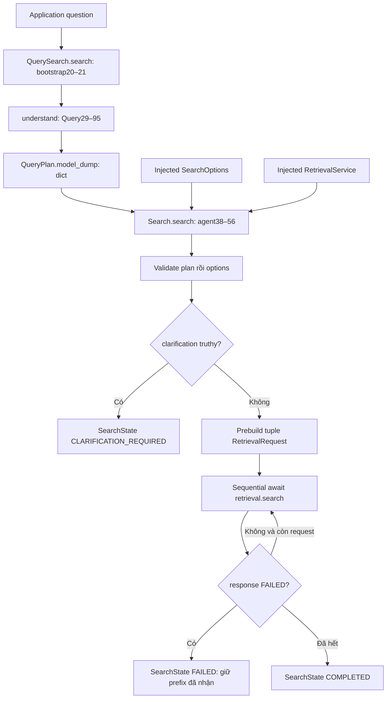
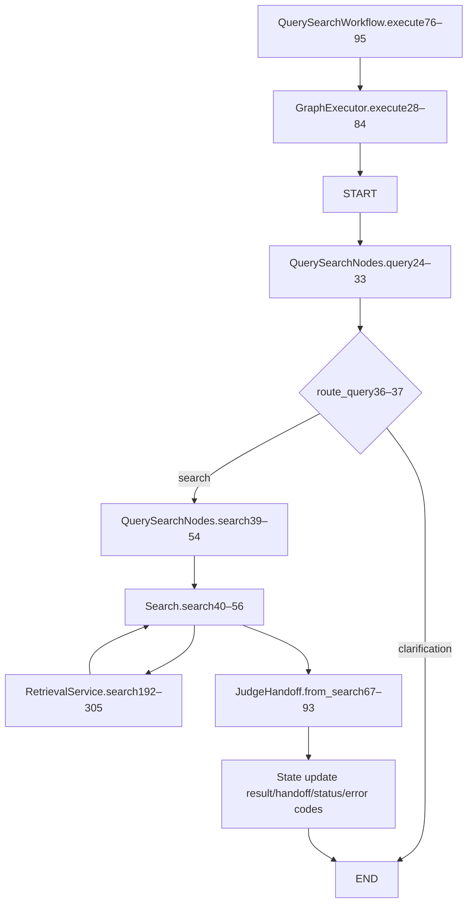

# Search Agent: kiến trúc và ownership thực tế

## Định danh từ executable source

 Search Agent là coroutine `search(plan: dict, retrieval: RetrievalService, options: SearchOptions) -> SearchState`, [agent.py38–56](../../../src/applications/tillegal/agents/search/agent.py). Nó là orchestration deterministic: validate, dựng requests, await service theo thứ tự, giữ native responses, dừng tại classified FAILED. Không có class Search Agent hoặc autonomous planning loop trong module này. Hai model/support types là SearchOptions và SearchState.

Tính deterministic của transport không làm database/model output deterministic: dependencies có thể đọc corpus thay đổi hoặc sinh request UUID /timestamp. Search không tự invoke model; service downstream có thể dùng E 5/ Cross-Encoder theo cấu hình. Phân biệt hai phạm vi này khi nói chi phí/latency.

| Câu hỏi năng lực | Kết luận và owner | Source / test evidence |
|---|---|---|
|1. LLM /hybrid/deterministic? |Deterministic transport; không LLM reasoning | Search 38–56 toàn thân; imports 3–10 |
|2. Tự invoke model? |Không; await retrieval.search | Search 47; multimode test_offline_real_dispatch_direct_parity_and_all_metadata |
|3. Tạo embeddings? |Không; service gọi injected query encoder |service 192–305, encoding 251–253; Dense mode assertions |
|4. BM25 / RRF ? |Không implement; service dispatch BM25 / Hybrid |service 195–245; Search 47 |
|5. Tự rerank? |Không; enabled flag thuộc service config |service 210–219; multimode parity rerank profile |
|6. Chọn mode? |Forward options.mode; không suy từ question | Search 44; test_untrusted_state_options_do_not_override_injection |
|7. Dựng RetrievalRequest ? |Có, toàn bộ trước calls | Search 44; request mapping test |
|8. Multiple subqueries? |1–4 parsed subqueries, một outer call mỗi phần nếu chưa fail | QueryPlan 25; Search 44–55 |
|9. Aggregate/dedup? |Đóng responses thành tuple, không union/dedup evidence | Search 45–56; duplicate diagnostic |
|10. Giữ ranking? |Giữ nguyên response objects, evidence order/rank | Search 48/53/56; identity/parity tests |
|11. Validate QueryPlan ? | QueryPlan. model_validate đầu tiên | Search 40; invalid-plan cases |
|12. Clarification? |Guard sau plan/options validation; Query tạo message, graph route skip node | Search 42–43; graph 36–37; clarification tests |
|13. Direct Supabase ? |Không; injected RetrievalService dùng adapters | Search 47; retrieval_bootstrap 22–70 |
|14. Tự chọn date/policy/ top_k ? |Không; application cung cấp bắt buộc | SearchOptions 18–21; bootstrap 34; mapping tests |
|15. Evidence sufficiency? |Không; COMPLETED là đã xử lý mọi phần | Search 56; no-match tests |
|16. Tạo JudgeHandoff ? |Không ở function Search; graph Search node tạo |graph 41–47; node identity test |
|17. Ownership phân tách? | Query lập plan; Search transport; Service retrieval; graph handoff/runtime |Các diagram dưới đây; source trace 10 |

Test paths/ranges cụ thể: [test_query_search.py30–113](../../../tests/unit/applications/tillegal/test_query_search.py), [test_query_search_multimode.py55–261](../../../tests/unit/applications/tillegal/test_query_search_multimode.py), [graph tests62–360](../../../tests/graph/test_query_search_workflow.py). Danh mục assertions đầy đủ ở 14/18.

## Hai execution paths



Standalone chỉ trả SearchState; không tự dựng handoff hoặc GraphExecutor context. Có thể gọi direct Search với plan không qua QuerySearch. Không gán mọi input validation upstream cho Search.



 Query node gọi understand trực tiếp; Search node gọi search trực tiếp. QuerySearch ở đây là dependency container, không bị gọi cả pipeline từ trong mỗi node. Không Judge node hoặc sufficiency decision sau handoff.

```mermaid
sequenceDiagram
 participant A as Application
 participant P as QuerySearch hoặc graph Search node
 participant S as Search.search
 participant V as QueryPlan/SearchOptions
 participant R as Injected RetrievalService
 A->>P: question hoặc merged state
 P->>S: plan dict, retrieval instance, options
 S->>V: model_validate(plan), model_validate(options)
 alt clarification truthy
 S-->>P: empty tuples, CLARIFICATION_REQUIRED
 else non-clarifying
 S->>S: prebuild toàn request tuple
 loop theo subquery order cho đến FAILED
 S->>R: await search(request)
 R-->>S: native typed response
 S->>S: append đúng object; kiểm status
 end
 S-->>P: SearchState
 end
 opt graph Search node đã chạy thành công
 P->>P: JudgeHandoff.from_search, validate context
 P-->>A: graph update rồi END
 end
```

## Construction, scope và exceptions

[create_query_search24–42](../../../src/query_search_bootstrap.py) validate options rồi delegate [create_retrieval_service22–70](../../../src/retrieval_bootstrap.py). Container frozen dataclass giữ service/options. Search function không khởi tạo model/client mỗi subquery. Nó tạo request tuple và response list mới mỗi invocation; không có cache/result global.

Graph nodes giữ cùng pipeline, workflow compile một lần. Các exceptions plan/options/request/dependency/handoff có boundary khác nhau; Search không catch exceptions. Classified FAILED là một response hợp lệ, không đồng nghĩa coroutine ném exception. Chi tiết 12; lifecycle 13 và graph 08. Model locks/worker cancellation không thuộc quyền Search, nên state isolation tests không chứng minh mọi production resource đã thread-safe.
