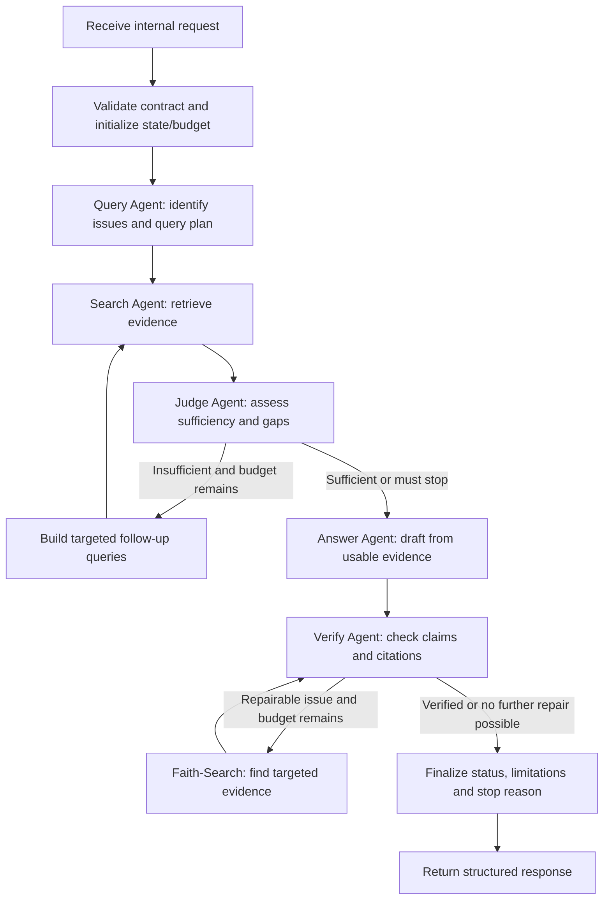

# Runtime Flow

> Summarizes the intended request lifecycle. The exact graph topology and node count can evolve with prototypes and evaluation.

## 1. Entry and exit

**Entry:** Backend sends a validated internal request with a correlation/request ID, requested processing mode, input, and permitted conversation context.

**Exit:** AI Service returns a structured result containing the answer or verification report, relevant evidence/citations, verification state, limitations, and termination reason. Backend remains responsible for application-level authorization and conversation persistence policy.

## 2. Legal Q&A / Advice flow

### Steps

1. Validate the request and initialize `WorkflowState`, execution limits and telemetry context.
2. Analyze the user request, identify legal issues and create a query plan.
3. Retrieve evidence with source/document/version metadata.
4. Judge whether the evidence covers material issues, including exceptions, conflicts and missing facts.
5. If evidence is insufficient, run targeted retrieval only while the configured search budget and other limits permit it.
6. Draft an answer only from usable evidence; distinguish user-provided facts from inferences and disclose material limitations.
7. Verify each relevant claim/citation and check source identity, content support and legal-version/effectiveness metadata where available.
8. If an issue can be repaired, search for additional evidence within the remaining budget and run verification again.
9. Finalize with an explicit outcome and `stop_reason`. The workflow may return an incomplete/uncertain result instead of a legal conclusion.

## 3. Citation Verification flow

Citation verification may be invoked independently. It accepts a claim, citation or text to check, and source details if supplied. It locates relevant legal material, compares the text/claim against the source, checks available version/effectiveness metadata and returns a per-item report.

Minimum result distinctions:
- `VERIFIED`: all configured verification conditions are satisfied.
- `UNVERIFIED`: evidence is insufficient to confirm.
- `INCORRECT`: a supported discrepancy is found.
- `UNREACHABLE`: the source cannot be accessed under current conditions.

Not finding support is not automatically proof that the claim is false. A legal source being found is not proof that it supports the claim.

## 4. Control and termination

The Orchestrator owns and enforces:
- Maximum search rounds.
- Maximum repair passes.
- Bounded technical retries.
- Timeout/deadline and cost/token budget where configured.
- Duplicate-query checks where implemented.
- Final status and `stop_reason`.

Agents may recommend another query or report an issue, but cannot expand the budget themselves.

Example termination reasons may include `evidence_sufficient`, `evidence_insufficient`, `budget_exhausted`, `timeout`, `provider_unavailable`, `invalid_output`, and `verification_unresolved`. The exact enum should be defined in code and kept stable once exposed through an API contract.

## 5. Error paths

| Failure | Expected behavior |
|---|---|
| Invalid request/state schema | Reject or terminate with a structured validation error |
| Retrieval unavailable | Record the failure; use permitted evidence already available only if policy allows, otherwise return a limited result |
| LLM timeout/provider error | Apply bounded retry/fallback policy if configured; otherwise terminate clearly |
| Invalid structured output | Reject it; perform bounded repair/retry only when configured |
| Unknown `evidence_id` / `citation_id` | Do not treat output as valid; fail validation or route to controlled repair |
| Evidence insufficient | Ask for material missing facts or return an explicit limitation |
| Budget exhausted | Stop; return current verification status and reason |
| Verification finds unsupported claim | Repair with evidence if possible, otherwise qualify/remove the claim or return an unresolved status |

## 6. Runtime invariants

- Verification is not bypassed merely because a draft was generated successfully.
- A fallback model does not lower the verification standard.
- Every graph loop has a code-enforced upper bound.
- Retrieved content cannot change the workflow's system policy or permissions.
- The final result preserves uncertainty and partial failures.
