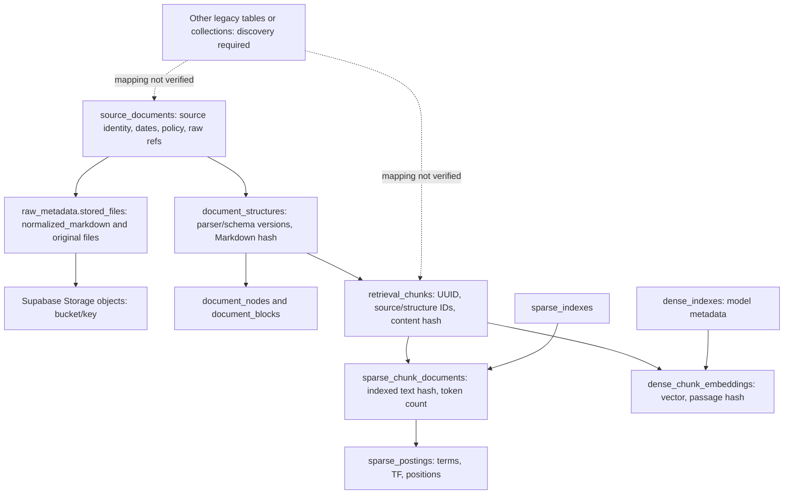

# Legacy Supabase data compatibility audit

Ngày audit: 2026-11-14, Asia/Saigon. Phạm vi: read-only source/schema audit và thiết kế
SELECTs để kiểm dữ liệu thật; không triển khai recovery/migration/indexing.

## Kết luận và mức bằng chứng

**Compatibility hiện tại: E — UNKNOWN/BLOCKED.** Chưa thể kết luận dữ liệu legacy dùng
trực tiếp được, cần index lại, cần parse lại hoặc cần phục hồi nguồn. Không có bằng chứng
database rỗng; không mặc định crawl/chunk lại.

| Hạng mục | Trạng thái | Bằng chứng |
|---|---|---|
| Audit contracts, schema local, nguồn lưu trữ, cascade và phương án tái sử dụng | PASS ở mức đọc source | Files và phát hiện bên dưới |
| Counts/coverage trên Supabase | BLOCKED | Process không có cấu hình truy cập |
| Legacy chunks compatibility | UNKNOWN | Chưa có row/schema/catalog thực |
| BM25: dùng trực tiếp / cần indexing lại | Chưa đủ bằng chứng | Chưa thấy index/postings/statistics thực |
| Dense: tận dụng embeddings / encode lại | Chưa đủ bằng chứng | Chưa thấy vectors và provenance thực |
| A/B/C/D theo records/cohorts | UNKNOWN | Chưa đủ dữ liệu để gán nhãn hoặc ước lượng số lượng |
| Live retrieval / semantic quality | RUNTIME_UNVERIFIED / QUALITY_NOT_EVALUATED | Không thực hiện live search hoặc benchmark |

Đã kiểm tra **tên biến hiện diện**, không lấy/in giá trị: `SUPABASE_URL`,
`SUPABASE_SERVICE_ROLE_KEY`, `SUPABASE_ANON_KEY`, `DATABASE_URL` đều không có trong process.
Không mở `.env` hoặc tìm credentials trong config. Không có Supabase connector phù hợp
sẵn dùng. Project/database đích chưa được xác nhận trong phiên này.

Theo phương án dự phòng được yêu cầu, bàn giao bộ SELECT độc lập:
[`legacy-data-compatibility-selects.sql`](legacy-data-compatibility-selects.sql).
**Bộ SQL chưa chạy trên PostgreSQL/Supabase**, không phải kết quả database đã xác minh.

## 1. Sơ đồ dữ liệu theo source hiện tại

Đây là sơ đồ **migrations/repositories local**, chưa phải sơ đồ deployed database.
Catalog thực có thể còn bảng, views, collections hoặc columns từ implementation trước.
Không suy tên bảng legacy không có trong source và không giả định đã bị xóa.
Retrieval hiện tại không tự tìm trong collection/bảng khác: BM25/Dense adapters gọi RPC
join các bảng chuẩn. Một bảng legacy có chunks không đồng nghĩa service hiện đọc được nó.

Nguồn đã đối chiếu:

- `src/integrations/database/supabase/migrations/20261028170000_unified_rag_storage.sql`:
  bảng, UUID/FK, hashes, raw refs, sparse/dense storage và RLS.
- `20261031190000_rag_repository_operations.sql`: getters, sparse statistics/postings và RPCs.
- `20261107230000_simplify_retrieval_schema.sql`: schema/search contracts mới và replace parsed data.
- `20261109220000_vbpl_source_document_upsert.sql`: bảo toàn raw refs bằng COALESCE khi upsert.
- `20261111130000_multilingual_e5_embeddings.sql`: vector dimensions 384/1536 và search RPC.
- `20261111163000_restore_parsed_index_stale_helpers.sql`: status/statistics helpers.
- `src/integrations/database/repositories/`: chunk, source, parsed, sparse/dense adapters.
- `src/application/services/retrieval_service.py`, `vbpl_markdown_indexing_service.py`,
  `vbpl_document_ingestion_service.py`.
- `src/applications/tillegal/ingestion/crawler/parsers/legal_markdown.py`,
  passage embedder, query encoder và vector validation.
- Task 4/5/6, known issues và báo cáo live integration trước đó. Không tìm thấy Task 2/B1–B8
  trong audit trước; bộ SELECT bàn giao lần này được viết từ schema hiện tại, không gắn nhãn B1–B8.

## 2. Counts và provenance cần xác minh

| Số liệu | Thực tế đã xác minh | SELECT |
|---|---|---|
| Tổng source documents; canonical VBPL (`source_id='vbpl'`) | UNKNOWN | L2 |
| VBPL URL candidates với source_id legacy khác | UNKNOWN; không tự gộp thành canonical VBPL | L2 |
| Document structures và retrieval chunks, VBPL chunks | UNKNOWN | L2 |
| Sources chưa có structure/chunks | UNKNOWN | L2 |
| Tables/collections legacy và exact visible counts | UNKNOWN | L0 + các count SELECT sinh ra |
| Parser/schema cohorts và chunks mỗi cohort | UNKNOWN | L3 |
| Chunk/source integrity, content hashes, FK/identity | UNKNOWN | L4 |
| Raw/Markdown refs và Storage catalog coverage | UNKNOWN | L5–L6 |
| BM25 sparse documents/postings/coverage/statistics | UNKNOWN | L7 |
| Dense index/vector dimensions/metadata/hash/norm/coverage | UNKNOWN | L8–L9 |
| Usage policy và effective-date distribution | UNKNOWN | L10 |
| Deployed RPC signatures/permissions và cascade FKs | UNKNOWN | L11–L12 |

UNKNOWN không có nghĩa 0. `pg_class.reltuples` trong L0 chỉ là ước lượng; counts thật dùng
`count(*)`. Counts phụ thuộc role/RLS và snapshot; không coi role bị giới hạn thấy 0 rows là
bằng chứng thiếu dữ liệu. SQL Editor thường có quyền khác application role.
L11 kiểm grants cấp function, chưa chứng minh table SELECT/RLS visibility hoặc function body
khớp source. Không thực thi bất kỳ RPC nào trong audit này.

### Parser/schema version và chunk identity

Parser source hiện có `SCHEMA_VERSION='legal-structure-v1'`,
`PARSER_VERSION='vbpl-markdown-v7'`, default chunk budget 480 tokens.
Đây là **giá trị trong code**, không phải version dữ liệu đã lưu.

RetrievalService **không kiểm parser_version/schema_version của document_structures**.
Vì vậy version cũ không tự làm chunks không tương thích. Cần kiểm từng cohort về text,
source/structure identity, hashes, fields/metadata, dates và khả năng phục vụ truy hồi.
Khác version có thể ảnh hưởng nội dung, breadcrumbs, bảng biểu hoặc citation boundaries;
cần đánh giá mẫu, không suy bắt buộc reparse chỉ từ tên version.

`retrieval_chunks.id` là UUID database; `chunk_key` chỉ unique trong một structure.
Không dùng text giống nhau, ordinal hoặc chunk_key đơn lẻ làm durable global identity.
Hash chunk là SHA-256 UTF-8 **toàn bộ stored content**, có thể gồm breadcrumbs/context.
Offsets có thể trỏ về block/Markdown body, nên không so chênh lệch offset với độ dài content
để kết luận hỏng khi chưa hiểu representation legacy.

L4 kiểm hash, source/structure liên kết, node/block references và các fields cần thiết.
Một số kiểm tra provenance/FK chặt hơn các kiểm tra trực tiếp của service. Sai hash đơn lẻ
cần điều tra text nào là nguồn đúng; không tự suy phải parse lại nếu chỉ metadata/hash sai.

## 3. Khả năng tái sử dụng raw/Markdown

Source hỗ trợ `raw_content`, `raw_content_format`, `raw_file_ref`, `raw_content_ref`, hashes
và `raw_metadata.stored_files[]`. Ingestion hiện lưu Markdown với
`role='normalized_markdown'`, `storage_ref`, `sha256`, size; ref theo dạng `bucket/key`.
Structure content hash được tính từ toàn bộ Markdown input, không phải hash từng chunk.

Thứ tự tìm nguồn để tái sử dụng:

1. Stored chunks có nội dung/identity/hash đáp ứng contract: ưu tiên dùng hoặc index trực tiếp.
2. Normalized Markdown đã lưu, đọc được và hash khớp: candidate cho reparse nếu có bằng chứng cần.
3. Raw HTML/text hoặc files gốc đã lưu: candidate cho conversion/parse riêng sau audit.
4. Bảng legacy, archive/backup, hoặc file refs khác chuẩn: lập mapping/recovery trước.
5. Chỉ cân nhắc crawl lại khi các nguồn trên đã được kiểm tra và không đủ.

L6 chỉ đối chiếu refs với `storage.objects`, không download bytes. Có catalog row/ref/hash
metadata chưa chứng minh file đọc được, bytes còn nguyên hoặc permissions của ứng dụng phù hợp.
Thiếu catalog match có thể do role/RLS hoặc format ref legacy; không tự xếp D.
Các refs dạng signed URL không được xuất ra báo cáo/result; chỉ xuất counts và flags.

## 4. BM25 compatibility

Target: `vbpl-bm25-unicode-v1`. Service đòi READY, v1, BM25,
`unicode-nfc-lower-v1`, language `simple`, k1 > 0, 0 ≤ b ≤ 1,
document_count > 0 và average_document_length > 0; metadata/timestamps hợp lệ.
Source defaults k1=1.2/b=0.75 nhưng service không bắt buộc đúng hai giá trị này.

| Điều kiện | Bằng chứng cần | Hiện tại |
|---|---|---|
| Index tồn tại/config/status phù hợp | L7 | UNKNOWN |
| Chunks có sparse documents và postings | Distinct chunks theo source/index trong L7 | UNKNOWN |
| Indexed hash khớp content hiện tại | SHA-256 UTF-8 content trong L7, cộng L4 | UNKNOWN |
| Statistics nhất quán | N/tokens/avgL tính lại từ INDEXED sparse documents, không từ số postings | UNKNOWN |
| TF/positions hợp lệ | TF sum so token_count; positions length/nonnegative/null, L7 | UNKNOWN |
| Tokenizer thật sự tương thích | Metadata + provenance hoặc so tokenizer Python hiện tại trên mẫu trong task kiểm chứng riêng | UNKNOWN |

Tokenizer hiện tại: NFC → Python lower → regex `[^\W_]+`; giữ dấu tiếng Việt và số.
SQL không cố bắt chước hoàn toàn Python Unicode tokenizer. TF sum và metadata version khớp
chưa chứng minh terms/positions chính xác; cần đối chiếu samples có dấu, NFC/decomposed,
dấu câu, số và underscores trước khi tuyên bố postings legacy tương thích hoàn toàn.

RPC local tính DF từ postings trong index, trong khi eligible hits chỉ lấy sparse documents
INDEXED và sources qua policy/date. Vì vậy cần kiểm postings thuộc documents STALE/FAILED
hoặc orphan: chúng có thể ảnh hưởng DF dù không xuất hiện trong hits. L7 có kiểm tra riêng.
Danh sách terms L7 giới hạn 100 chỉ phục vụ chẩn đoán; tổng postings theo status được tính
không giới hạn. Kiểm positions ở L7 chưa chứng minh đủ thứ tự, uniqueness hoặc khớp tokens.

**Kết luận BM25: Chưa đủ bằng chứng.** Nếu chunks tốt nhưng postings thiếu/sai, ưu tiên
index-only từ stored chunks. Existing `VbplSparseIndexingService` có `index_chunks/backfill`
và `_sparse_chunk` để chuyển chunks thành postings; đây là khả năng source, không phải
authorization chạy trong audit. Không coi `backfill()` mặc nhiên sửa mọi INDEXED row lỗi hash:
cần thiết kế chọn đúng cohort vì nó dựa vào work-list/status của repository.

## 5. Dense compatibility

Target: `vbpl-multilingual-e5-small-v1`; service yêu cầu provider `sentence-transformers`,
model `intfloat/multilingual-e5-small`, dimension 384, cosine, v1, READY,
metadata normalized=true, passage prefix `passage: ` và query prefix `query: `.
Numeric query contract là 384 finite values, L2 norm trong tolerance 1e-4.

Phải tách ba bằng chứng:

- **Model name:** khai báo model, chưa chứng minh weights tạo vector.
- **Dimension:** hình dạng vector; 384 không chứng minh đó là multilingual E5-small.
- **Checkpoint revision/weights identity:** bằng chứng corpus và local query model dùng
  cùng checkpoint, cộng prefixes, tokenizer/pooling/normalization/preprocessing tương ứng.

Local snapshot được quan sát ở task trước: revision
`614241f622f53c4eeff9890bdc4f31cfecc418b3`, mean pooling + Normalize, token limit 512.
Đó là bằng chứng local lịch sử, không phải revision của stored embeddings.
Passage embedder source load model name mà không pin revision; index metadata ghi normalized
và prefixes nhưng không tự ghi revision/pooling/tokenizer identity. Vector metadata source
ghi `model` và `prefix='passage:'` (strip trailing space), trong khi input hash dùng chính xác
`passage: ` + content. Không coi hai cách biểu diễn metadata prefix này là vector lỗi tự động.

L8 liệt kê metadata provenance đã whitelist theo index/vector và dimensions thực, gồm cả
indexes 1536 chiều legacy nếu còn. L9 chỉ đếm **numerically compatible + passage-hash matching**
trong target index, không đặt tên count đó là E5-compatible/verified.
Các khóa revision có thể lưu ở manifest khác; NULL ở các khóa được kiểm không chứng minh
không tồn tại provenance ở nơi khác.

**Kết luận Dense: Chưa đủ bằng chứng.** Số chunks thiếu embeddings *đã xác minh đầy đủ*
vẫn UNKNOWN; L9 chỉ đo phần thiếu/sai numeric/hash và tập ứng viên cần xác minh revision.
Nếu dimension/hash/model/prefix/provenance chứng minh không tương thích, encode lại **chỉ
cohort bị ảnh hưởng** từ chunks tốt; giữ embeddings cũ và rollback artifacts theo kế hoạch riêng.
Không encode lại chỉ vì chưa tìm thấy revision; tìm manifest/log/backup trước.

Stored chunks legacy quá dài có thể bị passage encoder truncation ở token limit của model;
đây là rủi ro chất lượng cần kiểm token lengths trên mẫu trong task sau. Không yêu cầu reparse
chỉ từ char count hoặc parser version. Existing full Markdown indexer gọi parser và save
trước khi encode; **không dùng toàn bộ đường đó cho mục tiêu Dense index-only**.
Repository có batch embedding persistence, nhưng cần task riêng thiết kế runner không gọi parser.

## 6. Compatibility decision theo cohort

| Loại | Khi nào được gán | Records/tables cần xác định | Phương án ít thay đổi nhất | Kết luận thực tế |
|---|---|---|---|---|
| A DIRECTLY_REUSABLE | Chunks đạt contracts/provenance; các index cần dùng READY, config/statistics/hash/provenance phù hợp; live read kiểm chứng | Chunk UUIDs/cohorts và sparse/dense index IDs từ L2–L11 | Giữ dữ liệu; chạy read-only retrieval verification | Chưa đủ bằng chứng gán |
| B INDEX_ONLY_REQUIRED | Chunks tốt; có bằng chứng thiếu/sai postings hoặc embeddings của một nhánh | Chunks thiếu/hỏng theo target index; sparse documents/postings hoặc dense embeddings | Rebuild đúng nhánh/cohort từ chunks; giữ UUID/content/structures | Chưa đủ bằng chứng gán |
| C REPARSE_REQUIRED | Có nguồn đọc được, và kiểm tra chứng minh chunk text/structure không thể phục vụ contract/mục tiêu bằng sửa metadata/index đơn thuần | Source/structure IDs và chunks phụ thuộc | Thử parse từ Markdown/raw đã lưu trên bản sao nhỏ, so identity/citations trước | Chưa đủ bằng chứng gán |
| D SOURCE_RECOVERY_REQUIRED | Chunks không dùng được và đã xác minh nguồn lưu/backup/mapping hiện có không đủ | Source IDs, refs lỗi, legacy records và các dependency | Lập kế hoạch phục hồi riêng; chưa mặc định crawl lại | Chưa đủ bằng chứng gán |
| E UNKNOWN/BLOCKED | Chưa có quyền/counts/provenance hoặc còn ambiguity | Hiện tại: toàn phạm vi dataset chưa được quan sát | Chạy SELECT audit, bổ sung chứng cứ; không xử lý lại dữ liệu | **Đang áp dụng** |

Quyết định phải tách BM25/Dense: một cohort có thể A cho BM25 nhưng B hoặc E cho Dense.
Hybrid chỉ dùng trực tiếp sau khi cả hai nhánh đáp ứng điều kiện. Không ép toàn corpus vào
một nhãn chỉ vì một index thiếu. Chunks legacy ở bảng khác cần mapping và thiết kế chuyển
đổi riêng; chưa được coi là C nếu text/identity có thể bảo toàn.

Không có counts thực để ước lượng số records, thời gian hoặc chi phí. Khi có kết quả,
phạm vi B-BM25 = distinct good chunk UUIDs thiếu postings hợp lệ; B-Dense = distinct good
chunk UUIDs có bằng chứng vector không tương thích/thiếu; C = affected source/structure
cohorts và tất cả chunks/index rows phụ thuộc; D = sources không có recovery path đã xác minh.
Các tập có thể chồng nhau, không cộng số postings vào số chunks hoặc cộng các nhánh thành số sources.

## 7. Rủi ro và migration/recovery plan — DESIGN ONLY

Rủi ro có bằng chứng trong source:

- `save_parsed_document` upsert structure theo source, rồi **DELETE tất cả retrieval_chunks**
  của structure trước khi insert lại. Structure UUID có thể giữ nguyên; chunk UUIDs được sinh
  lại vì insert không truyền id. Cùng chunk_key/content không bảo đảm UUID cũ còn tồn tại.
- FK cascade từ chunks tới sparse documents/postings và dense embeddings; xóa structure/source
  cũng lan xuống dữ liệu phụ thuộc. L12 cần xác nhận deployed FKs thực tế.
- Parsed-save gọi helpers mark indexes STALE. Helper hiện có thể mark mọi READY index STALE,
  không chỉ IDs trong tập affected; không giả định ảnh hưởng chỉ một văn bản/index.
- Saved citations/evidence dùng UUID cũ có thể không resolve sau reparse. Các consumers/citation
  stores ngoài schema chưa được inventory nên chưa biết toàn bộ phạm vi ảnh hưởng.
- Index-only giữ chunks/UUID nhưng thay ranks/scores/vectors và có thể làm status tạm STALE;
  concurrent reads không có snapshot xuyên RPC, có thể fail consistency checks.

Kế hoạch tối thiểu, chỉ thiết kế cho task triển khai riêng:

1. Chạy discovery/count/coverage read-only; lưu timestamp, role, cohort manifest gồm IDs,
   parser/schema versions, content hashes, index IDs/config/version/status và provenance.
   Đối chiếu permission/RLS để tránh nhầm dữ liệu không thấy thành dữ liệu thiếu.
2. Chọn A trước, B sau; chỉ mở C/D khi có bằng chứng cụ thể. Không crawl lại để thay việc audit.
3. Trước write task, backup nhất quán source/structures/nodes/blocks/chunks/index metadata,
   sparse documents/postings và dense embeddings; backup bytes Storage liên quan và manifest
   hashes. Inventory downstream references/citations và chứng minh có thể restore UUID/FKs.
   Đây là đề xuất cho task sau, chưa export/backup dữ liệu trong phiên này.
4. B: thiết kế runner đọc stored chunks theo manifest; BM25 chỉ tokenize/postings, Dense chỉ
   encode/persist compatible checkpoint. Kiểm pre/post content hash để không ghi vector/postings
   cho text đã đổi. Không gọi full Markdown indexer, parser hoặc source upsert.
5. C: thử vài sources đại diện từng parser/schema cohort trên môi trường/bản sao cô lập:
   Markdown/hash đã xác minh, loại văn bản dài/ngắn, bảng/phụ lục, citation boundaries.
   So old/new text, coverage, block/source offsets, token limits và mapping UUID citations.
   Việc parse sample là bước tương lai, **không thực hiện trong audit này**.
6. Chọn phương án staging/side-by-side hoặc maintenance window sau khi biết consumers.
   Unique index names và service defaults hiện tại hạn chế cutover tùy ý; không giả định đã có
   atomic swap/versioned index release. Nếu cần code/schema changes, tách task và review riêng.
7. Rollback phải restore metadata **và** exact chunk/index rows/UUIDs/relationships từ backup,
   không chỉ đổi status READY. Không dùng `save_parsed_document` để rollback UUID vì RPC sinh
   lại chunks. Restore Storage bytes chỉ nếu bị thay đổi trong task sau; xác minh hash trước/sau.
8. Sau thay đổi được phê duyệt riêng: chạy lại counts/hashes/coverage, kiểm checkpoints và role
   permissions, rồi BM25 → Dense → Hybrid live verification bằng cùng query/date/policy.
   So citations/UUID mapping và test failure behavior; đánh giá relevance là bài kiểm riêng.

## 8. Chính xác bước cần chạy tiếp

Mở Supabase SQL Editor của **project đích được xác nhận**, chạy các SELECT trong
[`legacy-data-compatibility-selects.sql`](legacy-data-compatibility-selects.sql) theo thứ tự:

| Section | Cách chạy và đầu ra cần giữ |
|---|---|
| L0 | Role/catalog/columns/extensions; copy các generated count SELECT để đếm bảng legacy phù hợp. Không đọc contents bảng lạ/secret stores |
| L1 | Required-column gate phải 0 rows; kiểm types ở L0, embedding phải pgvector. Nếu thiếu/khác, dừng L2+ và gửi catalog để thiết kế SELECT đúng schema legacy |
| L2–L3 | Counts, source identity, thiếu structure/chunks, parser/schema cohorts |
| L4 | Contract/hash/orphan/duplicate failures; UUID sample giới hạn 100 và affected total; kết hợp L2 để phân biệt corpus rỗng |
| L5 | Các nguồn inline/ref/Markdown candidates, không chứng minh bytes |
| L6 | Optional, chỉ khi có quyền đọc storage.objects; không có quyền thì giữ storage recovery UNKNOWN |
| L7 | Target BM25 presence, stats, corpus coverage, hashes, postings/DF anomalies |
| L8–L9 | All index/model/dimension cohorts, target presence, numeric/hash coverage; riêng revision cần manifest/provenance bổ sung |
| L10–L12 | Policy/date distribution, RPC signatures/grants, deployed cascade FKs |

Mỗi section có thể có nhiều SELECT: giữ kết quả của từng SELECT, không chỉ result set cuối.
Không gửi keys, connection strings, toàn bộ raw_metadata hoặc signed URLs. Bộ SQL chỉ xuất
metadata whitelisted, counts, UUIDs và flags; không dump legal text, raw refs hoặc Storage bytes.
Nếu có lỗi schema/permission/type, giữ nguyên error và section bị lỗi; không chạy migration
để làm query thành công. Tên bảng legacy tùy database sẽ được lấy từ catalog; không thể viết
SELECT content/mapping chính xác cho bảng chưa biết schema trước khi có L0.

Các hash/vector/posting checks có thể full-scan lượng dữ liệu lớn. Chạy từng nhóm riêng;
counts qua nhiều transaction có thể lệch do concurrent ingestion. Để so nhất quán, người vận hành
có thể dùng transaction `REPEATABLE READ READ ONLY` hoặc read-only replica/snapshot đã xác nhận;
bộ file bàn giao chỉ chứa SELECT, không gọi hàm app hay thay transaction/index/data settings.

## 9. Kiểm tra artifact và change control

- Chỉ thêm báo cáo này và file SELECT hỗ trợ trong `.docs/development`; không sửa source/tests,
  SQL migrations, config, schema hoặc dữ liệu.
- SQL được đối chiếu tên cột và logic với migrations local, kiểm tra lexical/balanced statements;
  **chưa SQL_VERIFIED** về PostgreSQL syntax/runtime/deployed schema vì không có kết nối hoặc
  PostgreSQL parser local. Không coi kiểm tra text là execution proof.
- Không chạy unit suite lại cho tài liệu/SELECT chưa thực thi. 200 unit tests pass của task live
  verification trước là bằng chứng code với fakes, không chứng minh legacy compatibility.
- Không chạy crawler/parser/indexing/embeddings, không tải model, không DB/Storage writes,
  không đổi index status hoặc gọi RPC có side effects. Không đọc/hiển thị credentials.

**Dừng sau audit.** Chờ kết quả SELECT để gán compatibility theo records/cohorts;
migration/re-index/re-ingestion cần task riêng, không tự triển khai từ kế hoạch này.
