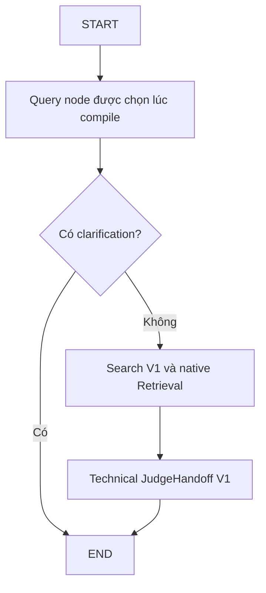

# Phase A — Implementation và kiến trúc

> Ghi chú publication: tài liệu ghi lại implementation/acceptance Phase A. Candidate PR được kiểm thử lại độc lập trên main sau V2; trạng thái Git/CI mới nhất được ghi trong FINAL_MAIN_INTEGRATION_REPORT.md (local). Source links đã đổi sang đường dẫn tương đối để review trên GitHub.

Ngày 27/11/2026. **READY FOR INTEGRATION cho phạm vi Phase A**, trạng thái ở acceptance ban đầu: chưa commit/push/merge. Thay đổi được triển khai trong thư mục project đúng và mirror vào detached worktree sạch trên Contract V2 commit `138470727518623662ce5608747fc1359255e227` (base main `9517bb597bad5eca56eb211b7bf59cf2493d48f8`). Không lấy source từ nhánh Judge/Summary.

## Vấn đề và thay đổi tối thiểu

Graph trước đây luôn gọi deterministic understand, bỏ qua query_agent dù facade đã được compose với Gemini. Phase A chỉ sửa một file production: `src/applications/tillegal/graphs/legal_qa.py`.

- Giữ nguyên [QuerySearchNodes.query](../../../src/applications/tillegal/graphs/legal_qa.py#L24) sync deterministic, các field trả về và caller trực tiếp.
- Thêm [QuerySearchNodes.query_semantic](../../../src/applications/tillegal/graphs/legal_qa.py#L35) async: lấy agent đã inject, await understand(question), trả cùng shape state. Gọi method này khi thiếu dependency trả QUERY_SEMANTIC_AGENT_REQUIRED, không fallback.
- [compile_query_search_graph](../../../src/applications/tillegal/graphs/legal_qa.py#L72) chọn query_semantic khi pipeline.query_agent is not None, nếu không vẫn chọn query cũ. Chọn dependency lúc compile, không đọc mode từ user state.
- Search node, conditional edges, handoff và QuerySearchWorkflow.execute giữ nguyên. Không gọi facade.search từ query node; không duplicate retrieval.

Không đổi QueryPlan, SearchOptions/SearchState, SemanticAnalysis, Gemini prompt/adapter/config, native RetrievalRequest/Response, aggregation, algorithms hoặc Contract V2. Không đổi Judge/Summary/Verification, crawler/DB hay API startup.

## Luồng được triển khai

Query node là sync deterministic hoặc async injected SemanticQueryAgent; graph không tự tạo provider/model. Handoff READY/NO_MATCH/RETRIEVAL_FAILED là trạng thái kỹ thuật, không phải Judge SUFFICIENT. Không có Judge/Summary node hoặc loop trong graph này.

## Production và test scope

Production: một async method mới và một dòng chọn query callable. Test: chỉ thêm imports/helper và 22 parametrized cases trong `tests/graph/test_query_search_workflow.py`. Đã so AST: mọi function/class test có trước vẫn nguyên vẹn; __init__/query/route_query/search có trước cũng nguyên vẹn. Không giảm assertion cũ.

Sáu tài liệu Phase A là artifact mới. Các audit integration-audit trước phản ánh code tại SHA đã ghim khi chưa làm A; không sửa các audit lịch sử đó để viết lại kết quả cũ. Kết quả test mới và call trace ở tài liệu 03/04.
